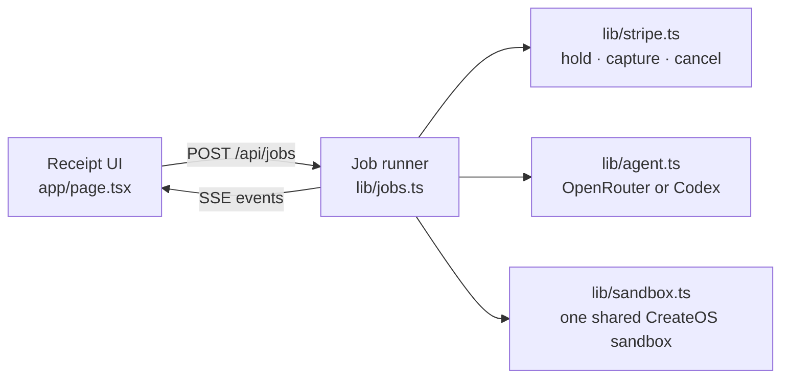

<div align="center">

<picture>
  <source media="(prefers-color-scheme: dark)" srcset=".github/assets/mark-inverse.svg">
  
</picture>

# Pay-on-Green

**An AI agent that fixes your failing test, and only gets paid if the tests go green.**<br>
Stripe holds $5 on your card. The agent's patch runs in a locked-down CreateOS Sandbox. Green captures the $5; red releases it.

[Live app](https://pay-on-green.timidan.xyz) · [How it works](#how-it-works) · [Fix your own repo](#fix-your-own-repo) · [Quickstart](#quickstart) · [Architecture](#architecture) · [API](#api)


[](LICENSE)

</div>

Coding agents are paid whether or not their code works. Pay-on-Green flips that. Before the agent starts, Stripe authorizes a **$5 hold** on the buyer's card. The agent reads the failing test, writes a patch, and runs the suite inside a **CreateOS Sandbox**: a Firecracker micro-VM that can reach one host and nothing else. If the tests pass, the server **captures** the hold. If the agent fails three times, the server **cancels** it, and the buyer pays nothing.

> [!IMPORTANT]
> Payments run in Stripe **test mode** only. The server refuses to start a job unless its key begins with `sk_test_`, and the demo card is Stripe's `pm_card_visa` test card. No real money moves.

## Highlights

- **Works on your repo.** Paste a public GitHub repository with a failing test (Node: Vitest, Jest or `node:test`). The agent fixes it in the sandbox, and you get a patch you apply with `git apply`.
- **Paid on proof, not on effort.** A `PaymentIntent` with `capture_method: "manual"` is authorized up front and settled exactly once: captured after a passing run, cancelled on every other exit, including errors and timeouts.
- **The agent can't edit its way to green.** Patches that touch `test/` are rejected. Before every run the server deletes `test/` and rewrites it from its own copy, then runs the test command itself.
- **Green is checked, not assumed.** A pass needs exit code 0 *and* node's own summary showing every expected test passed with none failing, so a patch can't fake success by exiting early.
- **Built to demo live.** Each model call is capped at 25 s and falls back through four free models; a lost sandbox is recreated once; every job finishes within four minutes, settled.
- **Untrusted code stays boxed.** The sandbox's egress allowlist holds a single host. Stripe, CreateOS and model keys never enter it; only source files do.
- **Everything on one receipt.** The page prints each step as it happens (the hold, the sandbox, the red baseline, each patch, each run) and stamps the result: **CAPTURED** or **RELEASED, you paid $0**.

## Built with

| | Role |
|---|---|
| **Stripe Projects** | Provisions the stack and writes its credentials to `.env` |
| **Stripe** (test mode) | The $5 hold, then capture on green or cancel on failure |
| **CreateOS Sandbox** | Runs the agent's patch with `node --test`, egress locked to one host |
| **OpenRouter** (free plan, via Stripe Projects) | The model that writes the patch: `nvidia/nemotron-3-super-120b-a12b:free`, with fallbacks |

```bash
stripe projects init pay-on-green
stripe projects add createos/project
stripe projects add openrouter/free
```

## How it works

```mermaid
sequenceDiagram
    actor Buyer
    participant App as Pay-on-Green
    participant Stripe
    participant Box as CreateOS Sandbox
    participant Model as OpenRouter model

    Buyer->>App: Fix it for $5
    App->>Stripe: PaymentIntent, capture_method=manual
    Stripe-->>App: requires_capture (the hold)
    App->>Box: write the repo, run node --test
    Box-->>App: red baseline
    loop up to 3 attempts
        App->>Model: source, tests (read-only), last output
        Model-->>App: patch as JSON
        App->>App: reject patches to test/ or process exits
        App->>Box: apply patch, restore tests, run node --test
        Box-->>App: pass/fail counts
    end
    alt every expected test passed
        App->>Stripe: capture
        Stripe-->>Buyer: charged $5
    else three failures, error or timeout
        App->>Stripe: cancel
        Stripe-->>Buyer: hold released, $0
    end
```

**Who pays:** a developer pays $5 per fixed failing test. Stripe authorizes it up front and captures it only after the suite passes in the sandbox. If the agent fails, the hold is released and they pay $0.

## Fix your own repo

1. Pick **Your repo** and paste a public GitHub URL, for example the [sample repo](https://github.com/Timidan/pay-on-green-sample). Add a test file path if you only want one file run.
2. Stripe places the $5 hold. The sandbox clones the repo (`--depth 1`) and installs dependencies with **GitHub and npm reachable**.
3. The network is **locked to npm only before the agent writes any code**.
4. The test files, `package.json`, the lockfile and the test and TypeScript configs are **protected**: a patch that touches them is rejected, and they're restored from git before every run.
5. **Green** means exit code 0, zero failures, and at least as many tests as the red baseline, using the runner's own counts. A patch can't pass by making tests disappear.
6. On green, the hold is captured and you get the **cumulative patch**: download it and run `git apply pay-on-green.patch`. If your tests already pass, nothing is charged.

| Limit | Value |
|---|---|
| Repositories | Public GitHub, Node.js |
| Test runners | Vitest, Jest, `node:test`, or `npm test` |
| Size | 200 MB after clone |
| Time | 8 minutes per job, 120 s per test run |

The demo also ships three seeded repositories:

| Task | Bug | Expected result |
|---|---|---|
| `split-bill` | Splitting $10 three ways loses a cent | Captured |
| `date-range` | An inclusive date range drops its last day | Captured |
| `unfixable` | One value asserted to be both 4 and 5 | Released after 3 attempts |

## Architecture



- **One Next.js process.** Jobs live in memory and stream to the page as Server-Sent Events. One job runs at a time; the next ones wait in a queue (up to five) and see their place in line.
- **One sandbox for the whole demo.** The CreateOS free plan allows one sandbox and ten creations a day, so the server creates it once, saves its id, and wipes `/work` between jobs.
- **A frozen contract.** [`lib/contract.ts`](lib/contract.ts) defines every event the UI renders. `?mock=fix` and `?mock=fail` replay recorded runs without any keys.

## Quickstart

Requires Node.js 22+ and the Stripe CLI with the Projects plugin.

```bash
git clone https://github.com/Timidan/pay-on-green && cd pay-on-green
npm install
stripe projects init pay-on-green
stripe projects add createos/project
stripe projects add openrouter/free
echo "STRIPE_SECRET_KEY=sk_test_..." >> .env
npm run dev
```

Open http://localhost:3000. To see the UI without keys: http://localhost:3000/?mock=fix.

## Configuration

| Variable | Required | Purpose |
|---|---|---|
| `STRIPE_SECRET_KEY` | yes | Stripe **test** secret key (`sk_test_…`) |
| `CREATEOS_PROJECT_API_KEY` | yes | Written by `stripe projects add createos/project` |
| `OPENROUTER_API_KEY` | for `openrouter` | Written by `stripe projects add openrouter/free` |
| `MODEL_BACKEND` | no | `openrouter` (default in Docker) or `codex` (local Codex CLI) |
| `SANDBOX_ID_FILE` | no | Where the shared sandbox id is stored (default `.sandbox-id`) |

## API

| Method | Path | Returns |
|---|---|---|
| `GET` | `/api/tasks` | The seeded tasks |
| `POST` | `/api/jobs` | Body `{ taskId }` or `{ repoUrl, testPath? }`. `202 { jobId }`; the job queues if another is running; `429` when five are already waiting |
| `GET` | `/api/jobs/:id/events` | `text/event-stream` of `JobEvent`s, replayed from the start on connect |

## Project structure

```
app/
  page.tsx               landing hero and the demo
  components/            Hero, Run (job view), Receipt, vendored effects in fx/
  api/                   tasks, jobs and the SSE event stream
lib/
  contract.ts            the UI ↔ job runner event types
  jobs.ts                the job loop and settlement
  agent.ts               model calls (OpenRouter with fallbacks, or Codex)
  sandbox.ts             the shared CreateOS sandbox
  stripe.ts              hold, capture, cancel
  tasks/                 the seeded repositories
  mock.ts                recorded runs for ?mock=
```

## Deploy

```bash
docker compose up -d --build
```

[`compose.yaml`](compose.yaml) runs one long-running container on an external `public_proxy` network behind a reverse proxy. The shared sandbox id persists in a named volume.

## Design

The look follows an "analyst's desk": a cool near-white surface, ink type in Geist, 1px borders, and a single accent. Here the accent is green, because green means paid. The receipt is the one warm, paper-like element. See [DESIGN.md](DESIGN.md).

## License

[MIT](LICENSE). Third-party code and trademarks are listed in [THIRD_PARTY_NOTICES.md](THIRD_PARTY_NOTICES.md).

Built in a day for the CreateOS × Stripe Projects hackathon, 17 October 2026.
